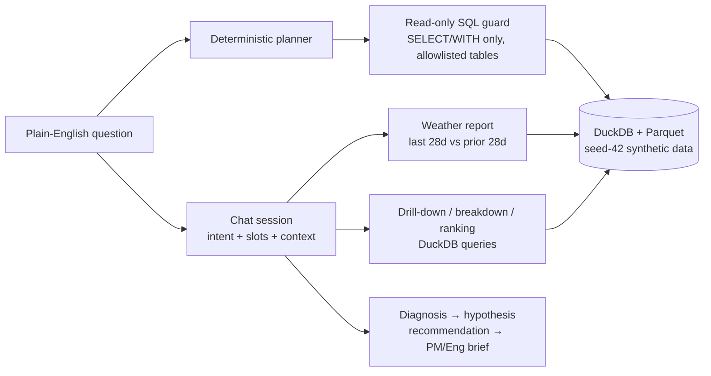

# SocialPulse NLQ (independent synthetic project)

An independently developed, deployed analytics application that enables
natural-language exploration of synthetic social-platform data. Built with
Python, DuckDB, deterministic query planning, multi-turn conversational
context, and evaluation workflows.

**Live demo:** https://socialpulse-nlq.onrender.com
— chat-only on load; click **Show dashboard** for the single-shot Ask UI,
the questions editor, and the experiment registry. The demo runs on a free
Render instance, so the first load after idle can take ~50 seconds to wake.
Edits made in the hosted questions editor are lost on redeploy; the repo is
the source of truth.

**Independent portfolio project using synthetic data; not affiliated with
Meta Platforms.** This is not Meta's tool. All data is synthetic, all code
in this repo is original, and no internal code, data, dashboards, or metric
definitions from any employer have been copied into it.

## What this is, in 30 seconds

A product-analytics assistant you can argue with — and check.

1. Ask a plain-English question about a social product (Instagram,
   WhatsApp, Facebook — all synthetic).
2. Get a **weather report**: DAU, WAU, retention, creator supply, messaging,
   and engagement for the last 28 days vs the prior 28, with watchouts.
3. Drill down, segment, and compare — by country, surface, or change over
   time — then get a **diagnosis** (what is problematic, in priority order),
   an **experiment recommendation** (a hypothesis to test, never a forecast),
   and a **PM/Eng brief** for a meeting.
4. Every answer carries its receipt: app, period, scope, and the numbers it
   is quoting. If a question cannot be answered from the data — an ambiguous
   metric, a filter that does not exist, a past-experiment lift with no
   assignment data — it clarifies instead of inventing an answer.

Project scope: 50K synthetic users, 12 tables, 90 days of activity, and
20 validated product metrics. Fully reproducible from a single seed (42).

## Try it: one real conversation

All numbers below are from the seed-42 data on the live demo, so you can
reproduce them exactly:

```
You: What is the current state of Instagram
Assistant: Instagram growth is up: mean daily DAU 4,544 in
  2026-03-04 to 2026-03-31, +4.8% vs the prior 28 days.
  Retention is up: D7 23.2%, +2.6 points. Creator supply is down:
  456 daily creators, penetration 10.1%.

You: What about WhatsApp?
Assistant: Whatsapp growth is up: mean daily DAU 2,972, +3.6%.
  Retention is down: D7 19.1%, -2.0 points. Creator supply is
  down: 301 daily creators, penetration 10.2%.

You: So you are saying Whatsapp creators are not creating as many
  chats, can you break it down by country?
Assistant [breakdown]: Creators by country, current period:
  US 590 (30.3%), IN 464 (23.8%), BR 281 (14.4%), ID 203 (10.4%),
  MX 163 (8.4%), GB 128 (6.6%), DE 117 (6.0%).
  This is a decomposition, not a cause.

You: Which country had the most drop in the last 2 weeks
Assistant [ranking]: The country with the largest drop is ID:
  159 vs 171 creators, -12, -7.0% (posts 462 vs 510).
  Total creators 1,575 vs 1,551, +24 — a small short-window move,
  not the Jan-Mar creator decline.
```

Follow-ups inherit context: "What about WhatsApp?" reuses the weather
intent with a new app; "same for WhatsApp" after a drill-down re-runs
that drill-down on the new app; "creators in India" filters the
drill-down; "what's driving the creator drop?" returns a country +
surface decomposition, never a cause.

## Architecture

Deterministic, no LLM, no model key. Natural language is the interface;
semantic correctness is the product.



Why deterministic, not an LLM chat: an LLM is free to invent a lift, a
cause, or a number on turn 3 that turn 1 never showed. Here a turn can
only surface numbers the weather report or a named query produced, and
the questions editor (`chat/questions.json`) lets a reviewer change the
flow — topics, diagnosis priority, recommendation hypotheses — without
touching code, with the change taking effect for the next chat.

Key decisions, with the reasoning in the docs:

- **Semantic catalog first.** Metrics are defined once, in
  `catalog/measures.yaml`, with grain and denominator — so "DAU" means
  the same thing in the weather report, the planner, and the chat.
  (The planner's SQL templates are currently hardcoded to mirror the
  catalog; making it truly catalog-driven is a documented cleanup, not
  a hidden shortcut.)
- **Receipts over claims.** Every answer states app, period, and scope.
  Orphan rate and top-1% share are whole-window levels, never trends.
  Recommendations are labelled HYPOTHESIS, never forecasts.
- **Sampled, not fake-scale.** Event tables are sampled / selectively
  materialised and most questions are answered from daily aggregates.
  The full-scale 500K-user, 12-month version is an opt-in generator run,
  not data committed to this repo — and never a claim about real users.

## Phases

### Phase 1: synthetic data foundation

- 50,000 synthetic users, 12 warehouse tables, 90 days of activity
  (2026-01-01 to 2026-03-31), fully reproducible from a single seed.
- A semantic catalog (`catalog/measures.yaml`) with 20 canonical metrics,
  each with a definition, grain, denominator, and hand-written SQL.
- A validation report proving the daily aggregates reconcile to the
  underlying events, instead of just asserting that they do.
- A schema designed for the full 24-table version from day one
  (see `docs/schema.md`); Phase 1 materialises 12 of those tables.

### Phase 2: deterministic planner (no LLM, no model key)

Ask in plain English. The planner maps the question to a canonical metric,
builds SQL from an allowlisted template (never from free-form user text),
checks it with the read-only SQL guard, runs it on DuckDB, and returns the
result plus a receipt: metric, grain, filters, tables used, and runtime.
If a question is ambiguous, asks for a metric that does not exist, or uses
a filter value that is not in the synthetic data, it asks for
clarification instead of inventing an answer.

Run the benchmark with `python scripts/run_benchmark.py --data data/phase1`.

### Phase 3: multi-turn chat

Weather → drill-down → diagnosis → hypothesis recommendation → PM/Eng
brief, as a deterministic state machine, with a both-in-one questions
editor (flow + single-shot evals + conversation evals, via
`GET`/`POST /api/questions`, validated atomic saves to those three files
only) and in-chat corrections (app, topic, grain daily vs average,
country/platform/surface/acquisition filters applied to the drill-down
series only; weather cards stay app-scoped).

The UI is chat-only by default: the dashboard is hidden on load and
returns with **Show dashboard**. The docked chat expands to full screen,
with charts rendered in the chat only (growth = daily DAU line, creators
= posts-per-month bars), and the input pinned at the bottom.

### Phase 4: turn-by-turn logic (current)

- **Step 1 — intent + slots + context.** Weather phrasings ("current
  state", "status", "overview" mean the same as "what's happening"),
  follow-ups ("What about WhatsApp?", "same for WhatsApp", "creators in
  India"), breakdowns by country/surface, and why-evidence as a
  decomposition, never a cause.
- **Ranking by change.** "Which country had the most drop in the last
  2 weeks?" ranks segments by change over two equal windows and names
  the top segment first, with the full list behind it — because a
  breakdown lists levels, and a change question needs a ranking.

## Metrics (20, canonical)

DAU (mean daily) · WAU (mean weekly) · MAU (March 2026) · DAU/MAU
stickiness · New users in window · D7 retention (exact, and by
acquisition source) · Sessions per DAU · Median session duration ·
Daily creators (mean) · Creator penetration · Posts per creator ·
Orphan post rate · Top-1% creator impression share · Reels/video
completion rate · Watch time per viewer per day · Messaging DAU ·
Two-way conversation rate · Commenter penetration · Engagement rate
per sampled impression.

Full definitions, grains, and denominators: `catalog/measures.yaml` and
`sql/canonical_metrics.sql`. The generator encodes causal-inspired
relationships with noise and confounding (social connections →
retention, first-post reply → creator retention, low reach → churn, ad
overload → satisfaction drop, crashes → retention drop) — see
`docs/synthetic-assumptions.md` for what is planted and what is NOT
encoded. Nothing here is a claim about a real product's metrics.

## Evals: how you know it works

| Suite | Result on seed-42 data |
|---|---|
| Phase 1 validation (metrics + reconciliation) | 20/20 metrics sane, 11/11 reconciliation |
| Single-shot benchmark (`evals/benchmark_phase2.json`) | **37/37** |
| Conversation benchmark (`evals/conversation_phase3.json`) | **8/8** multi-turn flows |
| Chat / questions / weather / planner unit tests | Green (see `tests/`) |

The benchmark grew the way a real eval set should: by probing the UI with
vague, PM-style questions ("How is Whatsapp doing recently?") and
codifying each probed question + its expected answer as a case — including
negative cases that must clarify or refuse (past-experiment evaluation
with no assignment tables, out-of-window periods, unknown apps).

Run them:

```bash
python scripts/run_benchmark.py --data data/phase1
python scripts/run_conversation_benchmark.py --data data/phase1
python tests/test_chat.py
```

GitHub Actions (`.github/workflows/phase2.yml`) runs the Phase 1
generator, validator, planner tests, and single-shot benchmark on every
push and pull request.

## Quickstart

```bash
python -m venv .venv && source .venv/bin/activate
pip install -r requirements.txt
python scripts/generate_phase1.py --seed 42 --out data/phase1
python scripts/validate_phase1.py --data data/phase1
python scripts/ask.py "What was DAU by app over the last 28 days?"
python scripts/app.py   # web UI at http://localhost:8000
```

Outputs: partitioned Parquet under `data/phase1/` (gitignored, ~111 MB —
generated locally, never committed), plus
`data/phase1/validation_report.json` and `validation_report.md`.

Deployed the same way on Render (free tier): `render.yaml` generates the
seed-42 data at build time and starts `python scripts/app.py --port $PORT`.
See `docs/render-deploy.md`.

## What this is not

- Not a billion-row warehouse, and not a claim about real Meta users,
  products, or dashboards. Metric names such as DAU or creator retention
  are standard product-analytics concepts; the definitions here are this
  project's own, documented in the catalog.
- Not a live LLM product, and not a causal-inference engine. It will not
  tell you why creators fell, or what lift an experiment will deliver.
  It will show you where the numbers sit, what is problematic by its
  stated thresholds, and what hypothesis is worth testing — with a
  primary metric, guardrails, and what would change its mind.
- Not a production system: no login on the demo, in-memory chat sessions
  (restarting the server resets history, by design), and hosted editor
  edits are lost on redeploy.

## Limitations and what's next

Honest gaps, in the order they matter:

1. **Compare-apps and period follow-ups** ("which app is growing
   fastest?", "last month vs the month before") are the next turn
   types — they clarify today.
2. **Creator cohorts** (new vs established) are the next decomposition,
   after country/surface. That needs a generator change, not just a
   query.
3. **Experiment assignment tables** would upgrade recommendations from
   hypotheses to past-experiment evidence. Deliberately out of scope
   until then — the refusal is the honest behaviour.
4. **Catalog-driven planner.** The planner's SQL templates currently
   mirror `catalog/measures.yaml` instead of reading it at runtime.
   Making it truly catalog-driven is a documented cleanup.
5. **Scale expansion** (500K users, 24 tables, 12 months, 75 benchmarks)
   is a separate fork, not a silent change to the default run.

## Repo layout

- `scripts/generate_phase1.py` — seeded synthetic generator
- `scripts/validate_phase1.py` — 20 canonical metrics + reconciliation
- `sql/canonical_metrics.sql` — the hand-written metric queries
- `catalog/measures.yaml` — metric definitions, grains, denominators
- `catalog/experiments.yaml` — experiment registry (descriptive; no
  assignment tables yet, so past-experiment evaluation clarifies)
- `src/socialpulse_nlq/planner.py` — deterministic planner + SQL guard
- `src/socialpulse_nlq/weather.py` — weather report (last 28d vs prior 28d)
- `src/socialpulse_nlq/chat.py` — multi-turn chat: intent, slots, context,
  breakdown, ranking, diagnosis, recommendation, brief
- `src/socialpulse_nlq/questions.py` — questions-editor backend
- `scripts/ask.py` — CLI for asking questions
- `scripts/chat.py` — CLI for multi-turn chat
- `scripts/app.py` + `app/index.html` — web UI (stdlib only, no CDN)
- `evals/benchmark_phase2.json` + `scripts/run_benchmark.py` — 37-question
  benchmark, 37/37 on seed-42 data
- `evals/conversation_phase3.json` + `scripts/run_conversation_benchmark.py`
  — 8 multi-turn conversations, 8/8
- `chat/questions.json` — chat flow (topics, diagnosis priority,
  recommendations), editable in the UI editor
- `docs/schema.md` — 24-table design, Phase 1 tables marked
- `docs/synthetic-assumptions.md` — planted relationships, and what is NOT encoded
- `docs/architecture-local.md` — local architecture (no cloud, no Copilot)
- `docs/phase2.md`, `docs/phase3-chat.md`, `docs/phase4-turn-by-turn-step1.md`,
  `docs/phase4-turn-by-turn-ranking.md` — phase notes, limits, and decisions
- `docs/interview-prep.md` — stage-by-stage interview guide

## Scale actually generated

Row counts are reported by the validation script after each run. Do not
quote a row count publicly until you have run the generator and read that
report; the report is the source of truth for this repo.
